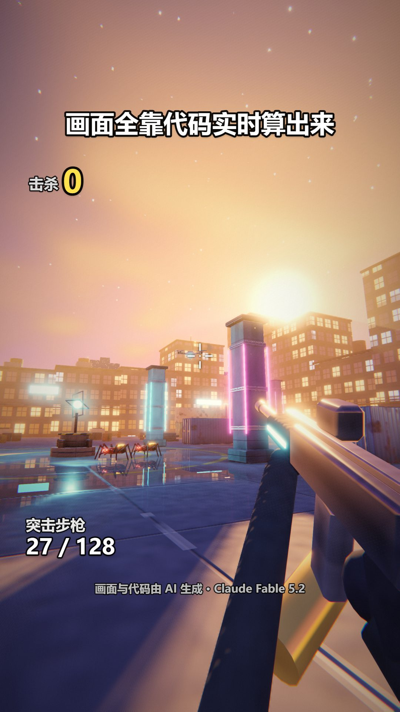

# 暮色哨站 DUSKWATCH

一个只有 **1 个 HTML 文件**（约 146KB）的浏览器 3D 第一人称射击游戏。没有任何外部模型、贴图或音频，画面和声音全部由代码实时生成。代码由 AI（Claude）编写。

**▶ 在线试玩：** https://zhaokangxin4-droid.github.io/duskwatch/

## 玩法

黄昏时分的城市天台，失控的机械从 8 个闸门不断涌入。守住哨站，撑过一波又一波——天色会随着波次从黄昏一路暗到深夜，中途还会下起暴雨。每 5 波出现一个重型首领。

每清完一波，可以从 3 张强化卡里选 1 张（共 16 种：伤害、弹匣、二段跳、穿甲弹、爆裂弹……），每一局的成长路线都不一样。

### 模式与难度

- **无尽生存**：一波接一波，每 5 波一个首领
- **限时三分钟**：180 秒内敌人不间断，比分数
- **首领连战**：每一波都是首领
- **无限火力**：弹匣永不减少，敌人也更多

难度分 菜鸟 / 标准 / 噩梦。菜鸟难度下敌人更弱，还可以开启「自动锁头」，准星会自动吸附到最近敌人的头部。每种模式和难度单独记录最高分。

### 电脑操作

| 操作 | 按键 |
| --- | --- |
| 移动 / 奔跑 / 跳跃 | `W` `A` `S` `D` / `Shift` / `空格` |
| 射击 / 瞄准 | 鼠标左键 / 右键 |
| 冲刺闪避（短暂无敌） | `E` |
| 近战 | `F` |
| 子弹时间（击杀充能） | `Q` |
| 切换武器 | `1`–`7` 或滚轮 |
| 换弹 / 暂停 | `R` / `Esc` |

### 手机操作

横屏打开即可：左侧虚拟摇杆移动，右侧滑动瞄准，准星对准敌人会自动开火，右下角是跳跃、冲刺、近战等按钮。手机上默认使用「低」画质。

### 内容

- **武器**：脉冲手枪（无限弹药）、破门霰弹、突击步枪、榴弹发射器、磁轨炮（穿透一切）、喷火器、电弧枪（连锁电击）
- **敌人**：爬行机、步兵、无人机、自爆滚雷、激光狙击手、重型机甲
- **首领**：有血条、震地冲击波（要跳起来躲）、半血后进入暴走阶段
- **生存**：能量护盾会自动回充，生命值靠补给和强化恢复
- 爆头双倍伤害，连杀有分数倍率，红色油桶可以打爆并连锁爆炸

## 画面技术

全部用 WebGL2 手写，没有使用游戏引擎：

- 基于物理的渲染（PBR）材质，程序化生成锈迹、磨损、窗户、木纹
- 动态昼夜：太阳西沉、月亮接替，天空、环境光、雾和窗户灯光随之变化，入夜后自动打开手电筒
- 天气：暴雨、闪电、积水扩大、水面涟漪
- 软阴影、屏幕空间环境光遮蔽（SSAO）、体积光
- 积水地面的实时平面倒影
- HDR 多级泛光、ACES 色调映射、FXAA 抗锯齿
- 烟雾、火球、弹孔、抛壳、冲击波等粒子特效
- 音效和背景音乐用 Web Audio 实时合成

## 运行

用新版 Chrome / Edge / Firefox 直接打开 `duskwatch.html` 即可，不需要安装任何东西。

画质分为 低 / 中 / 高 / 极致 四档，可以在菜单里切换；帧率过低时会自动降档。

`duskwatch_v1.html` 是最早的初版，留作对比。
